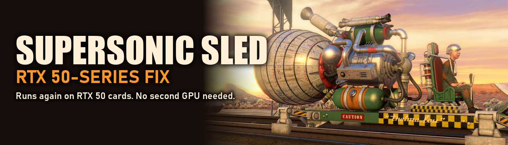

# Supersonic Sled: RTX 50-series fix

NVIDIA's 2010 **Supersonic Sled** tech demo crashes right after the splash screen on GeForce RTX 50-series (Blackwell) cards. This fix makes it run again, with all of its smoke, fire, debris and fluid effects.



## Why it crashes

The demo's particle, debris and smoke-fluid effects are 32-bit CUDA 3.0 code. RTX 50-series cards dropped 32-bit CUDA entirely (`cuInit` returns `CUDA_ERROR_NO_DEVICE` in a 32-bit process), so the demo gets no buffers and crashes. Reinstalling drivers, PhysX or DirectX can't help.

## How the fix works

It swaps in replacement DLLs that do the CUDA work on the CPU:

| File | What it does |
|---|---|
| `cudart32_30_11.dll` | A CPU implementation of the CUDA 3.0 runtime functions the demo imports: memory, arrays, textures with bilinear filtering, kernel launches on a thread pool, and Direct3D 11 interop through staging copies |
| `cufft32_30_11.dll` | The 128×128 real/complex 2D FFTs used by the smoke fluid solver |
| `nvcuda.dll` | A stub for the two driver API calls the exe imports directly |

The kernels themselves are **not rewritten by hand**. `tools/ptx2c.py` translates the PTX embedded in `SupersonicSled.exe` (19 kernels, sm_10, no shared memory or atomics) into plain C, instruction by instruction. The effects therefore behave like the original GPU code. Rendering stays on the graphics card and physics uses the legacy PhysX 2.8 engine.

## Install

Download the zip from **[Releases](../../releases)**, unzip it, and double-click `Install.bat`. It finds the demo (or asks for the folder), backs up the original DLLs to `bin\original_cuda_dlls`, and copies the fix in. `Uninstall.bat` restores the originals.

**Requirements**
- Supersonic Sled demo installed.
- NVIDIA PhysX Legacy System Software 9.13.0604 (free from NVIDIA's website).
- A decent multi-core CPU, since the effects now run on the processor.

Tested on an RTX 5080. It should work on any RTX 50-series card, because it no longer uses the GPU for CUDA.

## Building from source

You need Python 3 and the [Zig](https://ziglang.org/download/) compiler (used as a 32-bit Windows C compiler). The demo's own GPU code isn't in this repo, because it belongs to NVIDIA. The build pulls it out of your copy of the exe:

```sh
ZIG=path/to/zig.exe ./build.sh "D:/SuperSonicSled/bin/SupersonicSled.exe"
```

The DLLs land in `out/`. Every export is `__stdcall`, and each one's argument stack size matches the original NVIDIA DLL.

A log is written to `bin\cpu_cuda_log.txt` next to the demo. Set `SLED_CUDA_VERBOSE=1` for more detail.

## Credits

- Supersonic Sled is © NVIDIA Corporation. This is an unofficial fan fix, not affiliated with or endorsed by NVIDIA, and it contains no NVIDIA files.
- Built by TheMrEWP with [Claude Code](https://claude.com/claude-code) (Claude Opus 5.5).
- MIT licensed (see `LICENSE`). The license covers this project's own code only.
